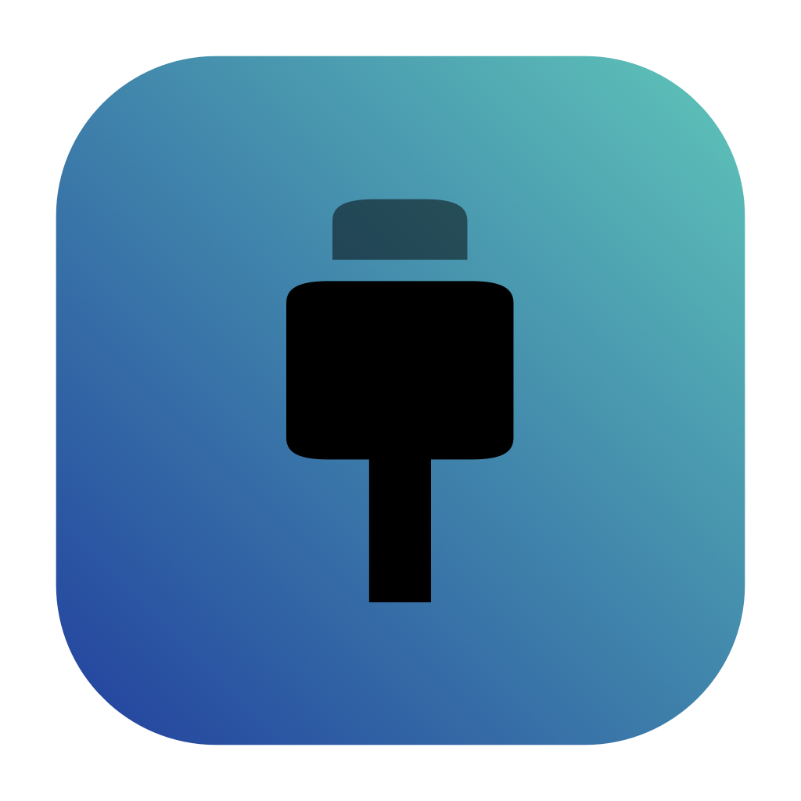

<p align="center">
  
</p>
<h1 align="center">USB Link</h1>
<p align="center"><strong>Android USB tethering. Integrated with macOS.</strong><br>A DriverKit-based RNDIS driver with a lightweight management app.</p>
<p align="center">
  <a href="https://github.com/ProvenceJake/usb-link/releases"></a>
  
  
  <a href="LICENSE"></a>
</p>
<p align="center"><strong>English</strong> · <a href="README.zh-CN.md">简体中文</a></p>
<p align="center">
  <a href="https://github.com/ProvenceJake/usb-link/releases/download/v0.1.0-preview.1/USB-Link-0.1.0-preview.1-arm64.dmg"><strong>Download for Apple Silicon</strong></a> ·
  <a href="https://github.com/ProvenceJake/usb-link/releases">Release notes</a> ·
  <a href="DriverKit/README.md">Developer guide</a> ·
  <a href="https://github.com/ProvenceJake/usb-link/issues">Report an issue</a>
</p>

---

USB Link connects Android phones, mobile hotspots, and other devices exposing an **RNDIS USB network interface** to the macOS network stack. It focuses on low resource use, bounded error handling, and reconnection that stays under your control.

> [!IMPORTANT]
> **Experimental developer preview — not a plug-and-play signed installer.**
> The downloadable app is ad-hoc signed and not notarized. Driver activation requires a Mac configured for local DriverKit development according to [Apple's documentation](https://developer.apple.com/documentation/driverkit/communicating-between-a-driverkit-extension-and-a-client-app). Copying the app to Applications does not grant system-extension authorization.

## Built for a quiet desktop

| Native integration | On-demand management | Controlled recovery |
| --- | --- | --- |
| DriverKit connects supported RNDIS devices to the macOS network stack. | Close the app while keeping the driver connection available. No additional always-running management service. | Reconnect manually with temporary device/network observers. No idle polling or automatic device resets. |

The data path checks TX lengths and short writes, bounds consecutive transfer errors, and cancels callbacks before normal resource teardown. Matching uses USB interface classes rather than a single device's vendor/product ID.

## Get connected

1. Download the [Apple Silicon DMG](https://github.com/ProvenceJake/usb-link/releases/download/v0.1.0-preview.1/USB-Link-0.1.0-preview.1-arm64.dmg) and read the included installation notes.
2. Copy **USB Link.app** to **Applications**. On a suitably configured development Mac, use the app's install/update action and complete system approval.
3. Connect a data-capable USB cable and enable **USB tethering** on the Android device when required.
4. Keep the host app installed. You can close its window during normal use; use **software reconnect** when you need to reconnect the device.

The DMG includes an Applications shortcut, English installation notes, the GPL license, attribution, and corresponding source. Its checksum is available in [SHA256SUMS.txt](https://github.com/ProvenceJake/usb-link/releases/download/v0.1.0-preview.1/SHA256SUMS.txt). The app UI is currently primarily Chinese; this repository has English and Chinese introductions.

## Compatibility

| Component | Current scope |
| --- | --- |
| Mac | Apple Silicon / arm64; Intel builds are not validated |
| macOS | Deployment target 13+; limited runtime testing on macOS 15.8.3 |
| Android devices | Phones and hotspots exposing a supported RNDIS interface |
| USB modes | RNDIS only; ECM, NCM, MTP, charging-only, and ADB are not handled |
| Cellular connection | Managed by the Android device, independently of this driver |

Broad matching does not mean every Android device has been tested. Some devices use different USB networking protocols and do not need, or cannot use, this driver.

## Build from source

Requires full Xcode with the DriverKit and NetworkingDriverKit SDKs.

```sh
git clone https://github.com/ProvenceJake/usb-link.git
cd usb-link
./DriverKit/build-local-test.sh
```

The script produces an arm64 Release app with a local ad-hoc signature and separate dSYMs in `DriverKit/Packages/`. It verifies signatures, symbol UUIDs, and ZIP integrity, then removes its build cache and superseded candidate ZIPs while retaining rollback archives. **It does not install or activate the driver.**

For provisioned distribution, use an Apple Developer team with the necessary Apple-approved DriverKit entitlements and signing configuration. See the [developer guide](DriverKit/README.md) for signing, tests, and DMG packaging.

## Validation, without overclaiming

| Check | Evidence so far |
| --- | --- |
| Unit tests | 20 passed: 15 protocol tests and 5 app-state/address-readiness tests |
| Hardware checks | Software reconnect, fixed-size HTTPS download, byte-for-byte upload echo integrity, and connectivity after closing the app |
| Resource sample | About 3.7 MiB driver RSS; 0.11 seconds of cumulative driver CPU time in a 30-second window without generated traffic |

The resource sample was short and background traffic was not isolated. It is **not a performance guarantee** or proof of superiority over other drivers. Long-running operation, sleep/wake, multiple devices, and injected USB short writes, cancellation failures, or late callbacks are not comprehensively validated.

<details>
<summary><strong>Known limitations and lifecycle behavior</strong></summary>

- Some DriverKit interfaces omit system Link state. A usable IPv4 address then indicates address readiness, not Internet reachability or complete driver health.
- USB reset is a synchronous system call and cannot be forcibly cancelled. The 30-second deadline releases observers, but app exit may wait for an in-flight reset to return.
- If action cancellation fails, resources are retained until driver process exit to avoid a possible use-after-free. This exceptional path still needs fault-injection testing.
- Keep the host app in Applications while using the extension. Use its driver-removal action before deleting the app.

</details>

## Contributing

[Report an issue](https://github.com/ProvenceJake/usb-link/issues) with your macOS version, Mac architecture, device model, USB networking mode, and steps to reproduce. Remove serial numbers, private addresses, credentials, and other personal information from logs before sharing them.

Changes that improve lifecycle correctness, reproducible tests, and idle resource use are especially welcome.

## Built on open source

USB Link is a modified derivative of [Prostec Labs TetherKit](https://github.com/prostec-labs/TetherKit), originally imported from [`e12c4a2`](https://github.com/prostec-labs/TetherKit/tree/e12c4a2fceb25a4ebdb3108f9357e0b1de148a58), with work inherited from [HoRNDIS](https://github.com/jwise/HoRNDIS) and the Linux RNDIS host implementation. It is not an official upstream release or a device-vendor product.

**GPL-3.0-or-later.** Original copyright notices are retained. See [NOTICE.md](NOTICE.md) for modifications and [LICENSE](LICENSE) for the full terms. Distributed without warranty.
