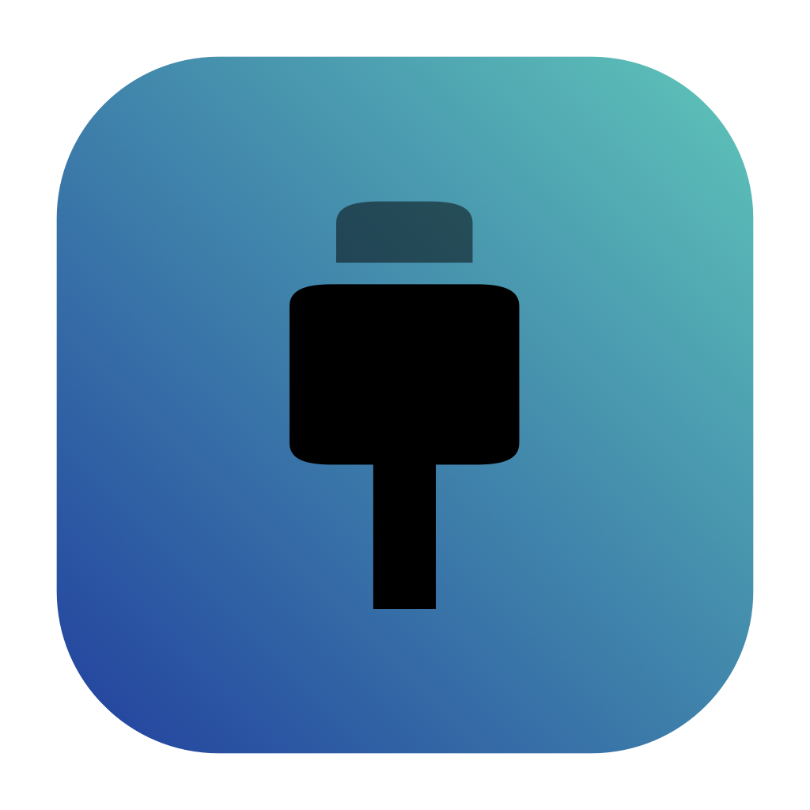

<p align="center">
  
</p>
<h1 align="center">USB Link</h1>
<p align="center"><strong>通过 USB，让安卓设备连接 macOS 网络。</strong><br>基于 DriverKit 的 RNDIS 驱动，搭配轻量管理应用。</p>
<p align="center">
  <a href="https://github.com/ProvenceJake/usb-link/releases"></a>
  
  
  <a href="LICENSE"></a>
</p>
<p align="center"><a href="README.md">English</a> · <strong>简体中文</strong></p>
<p align="center">
  <a href="https://github.com/ProvenceJake/usb-link/releases/download/v0.1.0-preview.1/USB-Link-0.1.0-preview.1-arm64.dmg"><strong>下载 Apple 芯片版</strong></a> ·
  <a href="https://github.com/ProvenceJake/usb-link/releases">版本说明</a> ·
  <a href="DriverKit/README.md">开发指南（英文）</a> ·
  <a href="https://github.com/ProvenceJake/usb-link/issues">反馈问题</a>
</p>

---

USB Link 将提供 **RNDIS USB 网络接口**的安卓手机、随身 Wi-Fi 及其他设备接入 macOS 网络栈，重点关注低资源占用、有界错误处理，以及由用户控制的软件重连。

> [!IMPORTANT]
> **这是实验性开发预览版，并非开箱即用的正式签名安装包。**
> 下载的 App 使用 Ad Hoc 本机签名，未经公证。激活驱动需要按照 [Apple 文档](https://developer.apple.com/documentation/driverkit/communicating-between-a-driverkit-extension-and-a-client-app)配置 DriverKit 本地开发环境。将 App 复制到“应用程序”并不等于获得系统扩展授权。

## 让管理应用保持安静

| 原生网络集成 | 按需管理 | 可控恢复 |
| --- | --- | --- |
| 通过 DriverKit 将受支持的 RNDIS 设备接入 macOS 网络栈。 | 关闭 App 后仍可保持驱动连接，无额外常驻管理服务。 | 用户主动发起重连，临时监听设备和网络事件，不做空闲轮询或自动重置。 |

数据路径检查发送长度与短写，限制连续传输错误后的处理，并在正常释放资源前取消回调。设备按 USB 接口类别匹配，不绑定某一款设备的厂商或产品 ID。

## 开始连接

1. 下载 [Apple 芯片版 DMG](https://github.com/ProvenceJake/usb-link/releases/download/v0.1.0-preview.1/USB-Link-0.1.0-preview.1-arm64.dmg)，阅读镜像中的安装说明。
2. 将 **USB Link.app** 复制到**应用程序**。在已正确配置的开发 Mac 上，通过 App 安装或更新驱动，并完成系统授权。
3. 使用支持数据传输的 USB 线连接安卓设备；如设备要求，请开启 **USB 网络共享**。
4. 保留承载驱动的 App。日常使用时可以关闭窗口，需要重新连接设备时使用**软件重连**。

DMG 包含“应用程序”快捷方式、英文安装说明、GPL 许可证、来源声明和对应源码。校验值见 [SHA256SUMS.txt](https://github.com/ProvenceJake/usb-link/releases/download/v0.1.0-preview.1/SHA256SUMS.txt)。App 界面目前以中文为主，仓库提供中英文介绍。

## 兼容范围

| 项目 | 当前范围 |
| --- | --- |
| Mac | Apple 芯片 / arm64；尚未验证 Intel 构建 |
| macOS | 部署目标为 13+；在 macOS 15.8.3 上进行过有限运行验证 |
| 安卓设备 | 提供受支持 RNDIS 接口的手机与移动热点 |
| USB 模式 | 仅 RNDIS；不处理 ECM、NCM、MTP、仅充电或 ADB 模式 |
| 蜂窝网络 | 由安卓设备自行管理，与此驱动独立 |

广泛匹配不代表每款安卓设备都经过验证。部分设备使用其他 USB 网络协议，不需要或无法使用此驱动。

## 从源码构建

需要完整 Xcode，以及 DriverKit 与 NetworkingDriverKit SDK。

```sh
git clone https://github.com/ProvenceJake/usb-link.git
cd usb-link
./DriverKit/build-local-test.sh
```

脚本在 `DriverKit/Packages/` 中生成 arm64 Release App、本机 Ad Hoc 签名与独立 dSYM。签名、符号 UUID 和 ZIP 完整性校验通过后，清理本次构建缓存及旧候选 ZIP，保留回退包。**脚本不会安装或激活驱动。**

正式分发需要 Apple Developer 团队、Apple 批准的 DriverKit 权限及适当的签名配置。签名、测试和 DMG 打包方法见[开发指南（英文）](DriverKit/README.md)。

## 验证结果与边界

| 检查项 | 当前证据 |
| --- | --- |
| 单元测试 | 20 项通过：15 项协议测试、5 项 App 状态及网络地址就绪测试 |
| 实机检查 | 软件重连、固定流量 HTTPS 下载、上传回显逐字节一致、关闭 App 后联网 |
| 资源样本 | 驱动 RSS 约 3.7 MiB；30 秒未主动产生流量时，累计驱动 CPU 时间约 0.11 秒 |

资源采样时间短，未隔离背景流量，**不构成性能保证**，也不能证明优于其他驱动。长时间运行、睡眠唤醒、多设备、人工注入 USB 短写、取消失败和迟到回调仍未得到充分验证。

<details>
<summary><strong>已知限制与资源释放行为</strong></summary>

- 某些 DriverKit 网卡不发布系统 Link 状态。此时有效 IPv4 地址仅表示地址就绪，不等于公网可达或驱动完全健康。
- USB reset 是无法强制取消的同步系统调用。30 秒超时会释放观察器，但 App 退出可能仍需等待正在执行的 reset 返回。
- 系统拒绝取消动作时，为避免迟到回调访问已释放内存，会将相关资源保留到驱动进程退出。该异常路径仍需故障注入验证。
- 使用系统扩展期间请将 App 保留在“应用程序”中；删除 App 前先使用其中的驱动卸载操作。

</details>

## 参与改进

欢迎[提交问题](https://github.com/ProvenceJake/usb-link/issues)，提供 macOS 版本、Mac 架构、设备型号、USB 网络模式和复现步骤。分享日志前请去除序列号、私人地址、凭据及其他个人信息。

尤其欢迎改善生命周期正确性、可复现测试和空闲资源占用的贡献。

## 开源来源

USB Link 基于 [Prostec Labs TetherKit](https://github.com/prostec-labs/TetherKit) 修改，原始参考提交为 [`e12c4a2`](https://github.com/prostec-labs/TetherKit/tree/e12c4a2fceb25a4ebdb3108f9357e0b1de148a58)，继承了 [HoRNDIS](https://github.com/jwise/HoRNDIS) 和 Linux RNDIS host 的工作。它不是上游官方发行版，也不隶属于设备厂商。

采用 **GPL-3.0-or-later**，保留原作者版权声明。修改说明见 [NOTICE.md](NOTICE.md)，完整条款见 [LICENSE](LICENSE)。本软件不提供任何担保。
